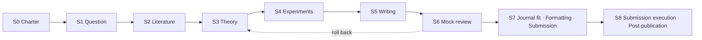

<div align="center">

# AI-StatPaper-PhD

**From project charter to publication: full-pipeline workflow · prompt library · skill pack · reproducible templates · automated checks**

Nine-stage pipeline · 38 copy-paste prompts · 10 installable skills · 8 checklists · 5 check scripts · 9 journal style profiles

*From research charter to published paper — AI does the grunt work, humans make the decisions, gates protect quality.*

**[中文文档](README.md)** · English

</div>

---

## What is this

An open-source engineering project **for statistics PhD students and early-career researchers** that turns "writing papers with AI" from a slogan into an executable, auditable, reproducible pipeline.

It does not generate papers. It lets you — with AI acceleration — produce **deep research questions, theory that survives line-by-line attack, reproducible simulations and real-data analyses, and academic prose rigorous down to formatting**.



Every stage ships with: **methodology** (`docs/`) → **prompts** (`prompts/`, P01–P38) →
**checklists** (`checklists/`, C1–C8) → **automated scripts** (`scripts/`, ×5) →
**journal style profiles** (`journals/`, ×9) → **one-click skills** (`skills/`, ×10, installable into Claude Code and other agent tools).

## Why you need it (unique strengths)

Existing AI-academia tools (OpenScholar, Polaris, ARS, GPT Academic, prompt collections) solve the *general* academic problem. But **statistics papers have a hard core none of them handle**: theorem–proof systems, asymptotic theory, size calibration in simulations, coverage of the true parameter, JASA-style structural conventions. This project does five things they don't:

| # | Unique strength | In one line |
|---|---|---|
| 1 | **Theory-check pipeline** | Six classes of proof defects ($O_p$ algebra, event completeness, KKT conditions, dimension traps, phantom lemma citations) + dual-model cross-attack + counterexample construction — `prompts/en/03` + `checklists/en/C2` + `skills-en/stat-theory-check` |
| 2 | **Three-layer citation verification** | Existence → field consistency → content support; "unverifiable ≠ invalid"; one card per citation — `checklists/en/C6` + `skills-en/stat-citation-verify` + `scripts/citation_check.py` |
| 3 | **Experiment audit & number reconciliation** | Every number in the paper traces to a cell of the experiment output (±0.01 tolerance); fair-baseline protocol; smoke-test checklist — `prompts/en/04` + `checklists/en/C3` |
| 4 | **Gated nine-stage pipeline** | Each stage exits through a decidable gate; no pass, no entry; degrade loudly (`[AI-UNVERIFIED]`), never silently — `skills/stat-pipeline` + `docs/01` |
| 5 | **Bilingual statistical depth** | 60+ entry CN–EN glossary (estimator vs. estimate) + translation discipline + JASA-style LaTeX skeleton — `docs/glossary-中英术语表.md` + `templates/latex/` |
| 6 | **Journal style profiles** ⭐ | 9 profiles for major statistics venues (JASA / AoS / Biometrika / JRSS-B / AOAS / Biometrics / SIM / JMLR / Chinese core journals) + the P28–P32 adaptation chain that reshapes a draft into venue-ready form — `journals/` + `skills-en/stat-journal-fit` |
| 7 | **AI-flavor symbol scanner** ⭐ | The 4th script `style_check.py`: em-dash asides (digit-range en-dashes are kept — they are correct statistics style), 30+ flagged words, connector density, Chinese AI tells — deterministic code doing symbol-level grunt work |
| 8 | **Final-draft checklist + one-shot orchestrator** ⭐ | Checklist C8 (venue formats item by item, citation closeout, theorem–appendix correspondence, meta-statement bans, experiment-purpose mapping) + `scripts/presubmit_check.py`, which aggregates all four scripts and adds eight deterministic checks (abstract/keyword counts, level-3 headings, list abuse, straight quotes, meta-statements, theorem-environment distribution, body–appendix proof correspondence, per-column decimals) |

The methodology reuses proven open-source practices (**Polaris**: deterministic code for grunt work + fact-pack number reconciliation; **AI Scientist**: review rubrics and ensemble aggregation; **OpenScholar**: self-feedback and citation verification; **open-academic-paper-gen**: three-layer citation checks; **Manubot**: paragraph-level AI revision; **awesome-ai-research-writing**: five-segment prompt skeleton, modification thresholds, AI-flavor word lists) — full lineage and sources in [docs/10-开源项目谱系.md](docs/10-开源项目谱系.md) (Chinese). Journal profiles (`journals/`) are compiled from public author guidelines and long-standing conventions; **always verify against the venue's current Author Guidelines before submitting**.

## Quick start (30 seconds)

```bash
git clone https://github.com/chenyiadam/AI-StatPaper-PhD.git
# 1) Try the deterministic checks — no model needed
python scripts/citation_check.py templates/latex/main.tex templates/latex/refs.bib
python scripts/notation_check.py templates/latex/main.tex
python scripts/style_check.py templates/latex/main.tex    # AI-flavor symbols & words
# or run everything in one shot (final-draft orchestrator):
python scripts/presubmit_check.py templates/latex/main.tex templates/latex/appendix.tex --bib templates/latex/refs.bib
# 2) Try the first prompt
#    Open prompts/en/01-research-question.md, paste P01 into any AI chat
# 3) Install all skills (Claude Code) — English versions:
cp -r skills-en/* your-paper-project/.claude/skills/
```

## Repository structure

```
AI-StatPaper-PhD/
├── README.md / README.en.md     ← you are here (CN / EN)
├── docs/                        Methodology, 11 files (Chinese; EN translation welcome)
├── prompts/                     Prompt library P01–P38 (Chinese canonical)
│   └── en/                      English versions, 1:1 with the Chinese files
├── journals/                    9 journal style profiles (Chinese canonical)
│   └── en/                      English versions
├── skills/                      10 installable skills (Chinese canonical)
├── skills-en/                   English SKILL.md versions (same skill names)
├── checklists/                  Checklists C1–C8 (Chinese canonical)
│   └── en/                      English versions
├── scripts/                     5 runnable check tools (stdlib-only, Python 3.8+)
│   ├── citation_check.py        text–bib consistency, field completeness, hallucination signals
│   ├── notation_check.py        duplicate macros/labels, dangling refs, "obviously" scan, TODO residue
│   ├── fig_table_check.py       figure/table reference closure, self-contained captions, booktabs rules
│   ├── style_check.py           AI-flavor symbols & words (em-dashes, flagged words, density)
│   └── presubmit_check.py ⭐     one-shot final-draft orchestrator: aggregates the four above +
│                                abstract/keyword counts, level-3 headings, list abuse, straight
│                                quotes, meta-statements, theorem-env distribution, body–appendix
│                                proof correspondence, per-column decimal precision
├── templates/                   LaTeX (JASA-style skeleton) · Quarto · simulation skeletons (R/Python) ·
│                                replication-package layout · cover letter · response letter
└── examples/                    Minimal worked demo (Chinese; the pipeline shapes are language-neutral)
```

⭐ = the strongest original contributions.

Note on languages: the **operational assets** (prompts, skills, checklists, journal profiles) ship in both Chinese and English. `docs/` (methodology essays), `examples/` and script log messages are currently Chinese-only — the scripts themselves work on English papers, and translations via PR are very welcome. The glossary is inherently bilingual.

## Recommended workflow (a methods paper)

| Week | Stage | Actions | Use |
|---|---|---|---|
| 1–2 | Question + literature | Refine the question, search, deep-read 30 papers | P01–P05 · C1 |
| 3–6 | Theory | Theorem landscape → proofs → dual-model attack | P08–P12 · C2 · skill: stat-theory-check |
| 5–8 | Experiments (parallel) | Design → audit → smoke test → full run | P13–P15 · C3 · templates/simulation |
| 8–10 | Writing | Section drafts → polish → de-AI-flavor | P17–P23 · C4 · skill: stat-writing |
| 11 | Mock review | Three reviewers × two rounds → fixes | P24–P27 · skill: stat-reviewer |
| 12 | Journal fit + submission | Style adaptation → presubmit_check → countdown → submit | journals/ · P28–P32 · presubmit_check · C5–C8 · skills: stat-journal-fit, stat-format-lint |
| 13+ | Submission execution & post-publication | System upload → preprint → status tracking & inquiries → decision routes → proofs | P33–P38 · docs/11 · skill: stat-postsub |

**Always on**: stat-citation-verify (every citation) · stat-pipeline (when lost, locate your stage).

## Toolchain (open-source ecosystem, pick per stage)

| Stage | Tool | Why |
|---|---|---|
| Reference management | [Zotero](https://www.zotero.org/) + [Better BibTeX](https://github.com/retorquere/zotero-better-bibtex) | citekey discipline, GB/T 7714 support |
| Literature QA | [OpenScholar](https://openscholar.allen.ai/) / [PaperQA2](https://github.com/Future-House/paper-qa) | grounded answers with real citations (still verify via C6) |
| Translation & polish | [GPT Academic](https://github.com/binary-husky/gpt_academic) | full-PDF/LaTeX translation, multi-model |
| Living papers | [Quarto](https://quarto.org/) | code, prose, figures in one file — numbers can't be mistyped |
| Final typesetting | LaTeX / Overleaf | pair with `templates/latex/` |
| Replication archiving | Zenodo / OSF | DOI for your replication package |
| Paper-as-code | [Manubot](https://manubot.org/) | Git + CI + PR-style collaboration |

## Three iron rules (if you disagree, please don't use this project)

1. **Every citation an AI gives you does not exist until you have verified it by hand.**
   (Citation hallucination rates of 78–90% for general-purpose models; OpenScholar, Nature 2026.)
2. **Every AI-generated proof is wrong until it has survived line-by-line review.**
3. **Every number in the paper must trace back to the experiment output.**

More on research integrity and AI-use disclosure: [docs/09-学术诚信与AI使用披露.md](docs/09-学术诚信与AI使用披露.md) (Chinese).

## Who this is for / not for

✅ **For**: PhD students and early-career researchers in statistics, biostatistics, econometrics; methods papers (method + theorems + simulation + data); people willing to trade verification work for quality.

❌ **Not for**: anyone wanting one-click paper generation (the project's design premise is the integrity rules above); purely theoretical math or pure reviews (partially applicable).

## Contributing

See [CONTRIBUTING.md](CONTRIBUTING.md). Especially welcome: direction-specific checklists (Bayesian computation, causal inference, functional data), more journal profiles, new check scripts, **English translations of `docs/` and `examples/`**, and "referee complaint → checklist item" conversions from real reviews.

## License & acknowledgements

Code and docs: MIT. This project synthesizes ideas and rules (not copyrighted text) from the open-source projects listed in [docs/10-开源项目谱系.md](docs/10-开源项目谱系.md) (OpenScholar · Polaris · open-academic-paper-gen · AI Scientist · PaperQA2 · Manubot · GPT Academic · awesome-ai-research-writing · ARS · Quarto · TIER Protocol, and others) — full credit and links there.

<div align="center">
<sub>If this saved you a month of detours, consider giving it a ⭐</sub>
</div>
