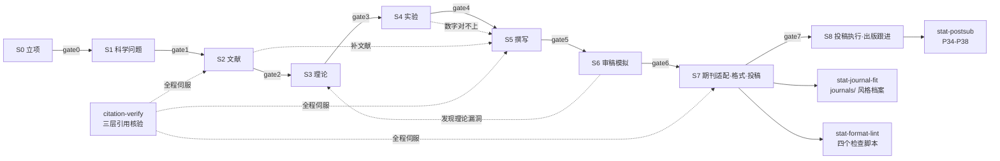

# 01 · 全流程总览：七阶段流水线

> 本项目把"用 AI 写博士水平的统计学论文"组织为**七阶段流水线**，
> 每阶段：方法论文档（本目录）+ 可执行提示词（`prompts/`）+ 检查清单（`checklists/`）
> + 自动化脚本（`scripts/`）+ 一键化 skill（`skills/`）。
> 阶段之间设**人工门禁**——AI 推进工作，人做决策（Polaris 的核心设计原则）。

## 总览图

回滚是常态而非异常：审稿模拟发现理论漏洞 → 回 S3；格式检查发现数字
对不上 → 回 S5/S4。流水线的价值在于**每次回滚只重跑受影响的下游阶段**。

## 五条全局原则（全项目的方法论内核）

1. **AI 产出研究起点，人产出结论。** 引用必须逐条核验（C6）；定理正确性由
   作者裁决（C2）；数字必须溯源到实验输出（C3）。AI 通过 ≠ 通过。
2. **确定性代码做重活，LLM 只做判断**（Polaris 原则）。检索、查重、编号、
   一致性检查全部由脚本完成（`scripts/`），便宜、可复现、可审计；LLM 负责
   设计、起草、审查、解读。
3. **一条提示词做一件事。** 32 条提示词各司其职（`prompts/README.md` 的
   十条纪律）；禁止"一口气生成论文"——那是 AI 味模板文的制造机。
4. **门禁制。** 每阶段出口有清单（下表）；门禁不过不进下一阶段；
   降级要大声（`[AI-待核验]` 标记），绝不悄悄混入。
5. **留痕即诚信。** 每阶段的 AI 对话存档 `project/ai_logs/`，AI 使用披露
   （`docs/09`）从留痕生成，不靠回忆。

## 阶段门禁表

| 阶段 | 核心交付物 | 门禁（全部满足才进入下一阶段） |
|---|---|---|
| S0 立项 | 研究章程一页（P33） | 里程碑/数据备选/算力/作者分工/预注册决策全部书面化 |
| S1 科学问题 | 问题陈述一页 + 贡献三条 | C1 全项有具体回答；问题落在统计性质上 |
| S2 文献 | 检索流水记录 + 笔记库 + refs.bib | 检索式可复现；所有引用过 L1/L2；空白地图成文 |
| S3 理论 | 定理体系 + 全部证明 | C2 逐项裁决 + 按 docs/11 §8.6 期刊档位校准检查强度 |
| S4 实验 | 场景网格 + 结果 CSV + 复现骨架 | 冒烟测试通过；C3 过审；基准公平性协议落实 |
| S5 撰写 | 全文初稿 | C4 过审；去 AI 味 + style_check 符号扫描完成；记号表同步 |
| S6 审稿模拟 | 三份意见 + 聚合清单 + 修复 | "必须修"清零；第二轮模拟验证 |
| S7 期刊适配·格式·投稿 | 该刊风格稿 + 可编译投稿包 | stat-journal-fit 七步走完；四个脚本零阻断；C7 完成 |
| S8 投稿执行·出版跟进 | 投稿编号 + 状态跟踪 + 决策响应 | P34 预检通过；通信存档；决策三路按 P37 执行 |

## 典型时间线（一篇方法型统计论文，供参考）

| 周 | 阶段 | 关键动作 |
|---|---|---|
| 1–2 | S1+S2 | P01–P04；文献池建立（100+ 篇筛到 30 精读） |
| 3–6 | S3 | 定理体系设计 → 证明 → P10 双模型交叉审查 |
| 5–8 | S4（与 S3 并行） | P13 设计 → 冒烟 → 全量跑 → P15 解读 |
| 8–10 | S5 | 各节起草 → 润色 → 去 AI 味 |
| 11 | S6 | 三审稿人两轮模拟 + 修复 |
| 12 | S7 | stat-journal-fit 期刊适配（P28–P32）→ 四脚本 + C7 倒计时 + 投稿 |

## 快速开始（30 分钟体验最小闭环）

不需要完整论文，用最小例子走一遍流水线的味道：

1. 克隆本仓库，打开 `templates/latex/main.tex`，看懂骨架注释里的要求；
2. 用 `prompts/01` 的 P01，把你的一个模糊想法凝练成问题陈述；
3. 用 `prompts/03` 的 P10，让 AI 攻击你手头任意一个证明（哪怕是教科书里的）；
4. 对 `templates/latex/refs.bib` 跑 `python scripts/citation_check.py main.tex refs.bib`，
   感受机械检查的输出形态；
5. 读 `checklists/C2-理论检查清单.md` C 组——这就是"博士水平"的日常。

## 导航

- 阶段方法论：`docs/02`–`docs/08`；伦理与披露：`docs/09`
- 借鉴谱系（我们站在谁肩膀上）：`docs/10-开源项目谱系.md`
- 一键化：`skills/stat-pipeline/SKILL.md`（安装见 `skills/README.md`）
